### About me

### Tech stack

### Featured projects

<table>
  <tr>
    <td width="50%" valign="top">
      <h3><a href="https://github.com/mehulp007/CricIQ">CricIQ</a></h3>
      Every IPL ball since 2008, replayable with a calibrated, explained win probability.  
      
      
      
        
      
      
    </td>
    <td width="50%" valign="top">
      <h3><a href="https://github.com/mehulp007/The-Virtual-Captain">The Virtual Captain</a></h3>
      An RL captain that sets all nine fielders for any batter, learned from 5.85M deliveries.  
      
      
      
        
      
      
    </td>
  </tr>
  <tr>
    <td width="50%" valign="top">
      <h3><a href="https://github.com/mehulp007/MARL">MARL Traffic Optimizer</a></h3>
      16 DQN agents run a city's traffic lights, with about 24% less time in the system than a fixed timer.  
      
      
      
        
      
    </td>
    <td width="50%" valign="top">
      <h3><a href="https://github.com/mehulp007/inkless">Inkless</a></h3>
      An Android expense tracker that fills itself from bank UPI SMS, sorted by an on-device model.  
      
      
      
        
      
      
    </td>
  </tr>
  <tr>
    <td width="50%" valign="top">
      <h3><a href="https://github.com/mehulp007/ECommerce-Intelligence-Engine">E-Commerce Intelligence Engine</a></h3>
      Recommendations, photo search and churn models over 31.8M H&amp;M purchases, plus a guarded Gemini copilot.  
      
      
      
        
      
    </td>
    <td width="50%" valign="top">
      <h3><a href="https://github.com/mehulp007/PayFlow">PayFlow</a></h3>
      Multi-tenant India payroll with Income-tax Act 2025 rules and maker-checker pay runs.  
      
      
      
        
      
    </td>
  </tr>
</table>

### What I write most

<!-- Languages card: replace YOUR-STATS-APP.vercel.app with your own github-readme-stats deployment (see SETUP.md). -->

### Connect

<!-- Replace the LinkedIn and portfolio placeholders with your real URLs. -->

